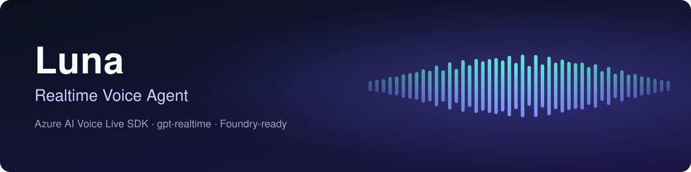

<p align="center">
  
</p>

# Realtime Voice Agent — Azure Voice Live (gpt-realtime-2.1) + optional Foundry Agent

A realtime voice assistant built on the **Azure AI Voice Live SDK**. You talk, it
replies in about a second or two, and (with headphones) you can interrupt it
mid-sentence. It runs in one of two modes, chosen by `VOICE_MODE` in `.env`, and
realtime mode can reach the model two ways:

| Mode | What runs | Use it for |
|---|---|---|
| **`realtime`** *(default)* | One speech-to-speech model, `gpt-realtime-2.1`, over a WebSocket. Reached through the **AI gateway** (`AI_GATEWAY_*` set; Bearer key) or directly via **Voice Live** (`VOICELIVE_*`; API key). | Fastest, most natural conversation. No Work IQ / MCP (optional local tools). |
| **`agent`** | Voice Live in front of a **Foundry prompt agent** (`gpt-5.6-terra`) with a cascaded pipeline (transcribe → LLM → TTS). Entra ID auth. Uses the Foundry SDK (`azure-ai-projects`) to create the agent. | When you need tools: **Work IQ** and **MCP** servers via a Foundry toolbox. |

```text
REALTIME MODE (default)
 Mic ─▶ AI gateway (/v1/realtime)  ─┐
        or Voice Live              ─┴▶ gpt-realtime-2.1 (hears audio, reasons, speaks audio) ─▶ Speaker

AGENT MODE (for Work IQ / MCP)
 Mic ─▶ Voice Live ─▶ mai-transcribe-2 ─▶ Foundry agent (gpt-5.6-terra + toolbox)
                                              │            └─▶ Work IQ / MCP servers
                                              ▼
                       Speaker ◀─ Azure neural voice (Ava Dragon HD)
```

For a full explanation of how every piece connects, see
**[ARCHITECTURE.md](ARCHITECTURE.md)**.

---

## TL;DR — run it

### Realtime mode via the AI gateway (default setup in this repo)

```bash
source .venv/bin/activate
# In .env: VOICE_MODE=realtime, AI_GATEWAY_BASE_URL=<url>, AI_GATEWAY_KEY=<key>, VOICE_NAME=alloy
.venv/bin/python scripts/check_gateway.py   # optional live check of the key + models
.venv/bin/python src/voice_client.py
```

No agent creation step is needed in this mode. Wear headphones, or leave the
echo guard on (see "Echo and speakers" below).

### Realtime mode via Voice Live directly

Leave `AI_GATEWAY_*` empty and set `VOICELIVE_ENDPOINT` + `VOICELIVE_API_KEY`.

### Agent mode (when you need Work IQ / MCP tools)

```bash
az login
# In .env: VOICE_MODE=agent, VOICE_NAME=en-US-Ava:DragonHDLatestNeural
.venv/bin/python src/create_agent.py   # creates/updates the Foundry agent
.venv/bin/python src/voice_client.py
```

Re-run `create_agent.py` whenever you change the agent's instructions, tools or
voice settings. Each run creates a new agent version.

### Pre-flight check

```bash
.venv/bin/python scripts/check_setup.py
```

In VS Code, these are the **F5** launch configs: *Pre-flight check*,
*Create voice agent*, *Run realtime voice client*, plus the optional
*Create Work IQ connection + toolbox* and *Smoke-test tools (text)*.

---

## Prerequisites

| Requirement | Notes |
|---|---|
| **Python 3.10+** | This repo uses a venv at `.venv` (Python 3.12 via `uv`). |
| **Azure CLI** + `az login` | Needed for **agent mode** (Entra ID only — no keys). |
| **A Foundry resource** with deployments | This repo uses `modelssweden-resource` with `gpt-realtime-2.1` (realtime mode) and `gpt-5.6-terra` (agent mode). |
| **AI gateway URL + key** *(gateway path)* | A LiteLLM virtual key (`sk-…`) limited to the models it was granted (here `gpt-realtime-2.1` and `gpt-5.6-terra`). Fetch it from your secret store; never commit it. |
| **Voice Live endpoint + API key** *(direct path)* | Same Foundry resource → "Keys and Endpoint". Only used in realtime mode without the gateway. |
| **Foundry User role** | On the project, for your signed-in account. |
| *(For Work IQ)* **azd ≥ 1.27.1** + `azure.ai.agents` ext, and a **Global Admin** for one-time setup | See "Work IQ setup". |

### Python environment (already set up in this repo)

Created with [`uv`](https://docs.astral.sh/uv/) using a local Python 3.12:

```bash
uv venv --python python3.12 .venv
uv pip install --python .venv/bin/python -r requirements.txt
```

### Audio: PyAudio → sounddevice shim (why)

The official Voice Live console sample uses **PyAudio**, which needs the system
**PortAudio** C library (installed via Homebrew/MacPorts — and MacPorts needs
sudo). This machine has neither available non-interactively, so this repo:

- installs **`sounddevice`** (it bundles PortAudio — no sudo), and
- includes [`src/pyaudio.py`](src/pyaudio.py), a tiny shim that maps the PyAudio
  API the sample expects onto `sounddevice`.

Result: [`src/voice_client.py`](src/voice_client.py) runs without PortAudio from
Homebrew/MacPorts. If you later `brew install portaudio && pip install pyaudio`, delete
`src/pyaudio.py` to use the real package.

---

## Configuration

Copy `.env.example` to `.env` and fill it in. Both scripts read the project-root
`.env`. `.env` is git-ignored — never commit the API key.

**Mode switch:**

| Variable | Description |
|---|---|
| `VOICE_MODE` | `realtime` (default) or `agent` |

**Realtime mode, AI gateway** (when **both** `AI_GATEWAY_*` are set, these win over `VOICELIVE_*`):

| Variable | Description |
|---|---|
| `AI_GATEWAY_BASE_URL` | Gateway URL, with or without `/v1` (the client connects to `wss://<gateway>/v1/realtime?model=…`) |
| `AI_GATEWAY_KEY` | LiteLLM virtual key, sent as `Authorization: Bearer` |
| `AI_GATEWAY_REALTIME_MODEL` | *(optional)* Default `gpt-realtime-2.1` |
| `AI_GATEWAY_CHAT_MODEL` | *(optional)* Chat model used by `scripts/check_gateway.py`, default `gpt-5.6-terra` |
| `AI_GATEWAY_EXTRA_MODELS` | *(optional)* Comma-separated extra models for `check_gateway.py` to test |
| `GATEWAY_TRANSCRIPTION_MODEL` | *(optional)* Default `whisper-1` (the gateway has no `azure-speech`) |
| `GATEWAY_TRANSCRIPTION_LANGUAGE` | *(optional)* Default `en`; stops Whisper guessing other languages |
| `GATEWAY_HALF_DUPLEX` | *(optional)* Default `1`: mic is muted while the agent speaks. Set `0` with headphones to allow barge-in |
| `GATEWAY_ECHO_TAIL_MS` | *(optional)* Extra mic mute after playback ends, default `500` |
| `GATEWAY_VAD_THRESHOLD` / `GATEWAY_NOISE_REDUCTION` | *(optional)* Defaults `0.6` / `far_field` (use `near_field` for a headset) |

Only one of `AI_GATEWAY_BASE_URL` / `AI_GATEWAY_KEY` set is an error.

**Realtime mode, Voice Live directly:**

| Variable | Description |
|---|---|
| `VOICELIVE_ENDPOINT` | `https://<resource>.services.ai.azure.com/` |
| `VOICELIVE_API_KEY` | Resource key (portal → Keys and Endpoint) |
| `VOICELIVE_MODEL` | Realtime model deployment, `gpt-realtime-2.1` |
| `VOICELIVE_API_VERSION` | `2026-04-10` (default) |
| `VOICE_NAME` | An OpenAI voice: `alloy`, `ash`, `ballad`, `coral`, `echo`, `sage`, `shimmer`, `verse`, `marin`, `cedar` |
| `REALTIME_INSTRUCTIONS` | *(optional)* Override the system prompt. Today's date is appended automatically. |
| `REALTIME_TRANSCRIPTION_MODEL` | *(optional)* Model for the "You said" transcript, default `azure-speech` |

**Agent mode:**

| Variable | Description |
|---|---|
| `PROJECT_ENDPOINT` | Foundry project endpoint: `https://<resource>.services.ai.azure.com/api/projects/<project>` |
| `PROJECT_NAME` | Project name (last segment of the endpoint) |
| `MODEL_DEPLOYMENT_NAME` | Agent's reasoning model, e.g. `gpt-5.6-terra` |
| `AGENT_NAME` | Name for the prompt agent (default `voice-agent`) |
| `VOICE_NAME` | Azure neural voice, e.g. `en-US-Ava:DragonHDLatestNeural` |
| `TRANSCRIPTION_MODEL` | *(optional)* Default `mai-transcribe-2`. Cascaded mode only accepts `azure-speech`, `azure-mrs` and the `mai-transcribe*` family. |
| `VOICE_INTERIM` | *(optional)* `1` to speak a "one moment…" filler while tools run |

**Microsoft Graph calendar tool (optional, realtime mode):**

| Variable | Description |
|---|---|
| `REALTIME_TOOLS` | `1` to offer local function tools to the model |
| `GRAPH_CLIENT_ID` | Entra app / public client used to sign in (enables the `get_calendar` tool) |
| `GRAPH_TENANT_ID` | Tenant id (default `organizations`) |
| `GRAPH_AUTH_FLOW` | `browser` (default) or `device` |

One-time sign-in: `python scripts/graph_login.py`. It requests only the delegated
`Calendars.Read` permission and reads only subject/start/end/all-day/cancelled.
**Tenant policy can block it**: in the Synapx tenant, device-code sign-in was
refused with `530033` (managed-device requirement). Leave `GRAPH_CLIENT_ID` empty
if you don't use it.

**Tools (optional — fill after Phase 2):**

| Variable | Description |
|---|---|
| `WORKIQ_TENANT_ID` / `WORKIQ_CLIENT_ID` / `WORKIQ_CLIENT_SECRET` | Entra app values for the Work IQ connection (input to `scripts/workiq_toolbox.py`) |
| `WORKIQ_CONNECTION_NAME` / `TOOLBOX_NAME` | Names (defaults `workiq-conn` / `work-iq-toolbox`) |
| `TOOLBOX_PROJECT_CONNECTION_ID` / `TOOLBOX_SERVER_URL` | Toolbox wiring used by `create_agent.py` (output of Phase 2) |
| `WORK_IQ_PROJECT_CONNECTION_ID` | Alternative: attach Work IQ directly, no toolbox |

---

## How it works (the code)

| File | Role |
|---|---|
| [`src/create_agent.py`](src/create_agent.py) | **Agent mode only.** Creates/updates the Foundry prompt agent: model + instructions + **optional tools** (toolbox MCP, or direct Work IQ), and stores the Voice Live session config (voice, transcription, semantic VAD, noise suppression, echo cancel) as chunked agent metadata. |
| [`src/voice_client.py`](src/voice_client.py) | The realtime client for both modes. Opens the WebSocket (by `model` in realtime mode, via the gateway when `AI_GATEWAY_*` is set; by `agent_name` + `project_name` in agent mode), configures the session, handles server events, supports **barge-in**, prints a `⏱️ First audio after N ms` latency line per turn, and logs to `src/logs/`. `GatewayConnectionManager` points the SDK at the gateway's `/v1/realtime`; gateway sessions use the GA realtime shape. |
| [`src/audio.py`](src/audio.py) | Mic capture and jitter-buffered playback, plus the half-duplex echo guard used on the gateway path. |
| [`src/local_tools.py`](src/local_tools.py) | Opt-in function tools for realtime mode (`REALTIME_TOOLS=1`). |
| [`src/graph_tools.py`](src/graph_tools.py) | Microsoft Graph calendar tool (meeting counts) with cached delegated sign-in. |
| [`src/pyaudio.py`](src/pyaudio.py) | `sounddevice`-backed `pyaudio` shim (see "Audio" above). |
| [`scripts/check_gateway.py`](scripts/check_gateway.py) | Live check of the gateway: chat model(s) plus the realtime WebSocket handshake. |
| [`scripts/graph_login.py`](scripts/graph_login.py) | One-time Graph sign-in, then prints this week's meetings. |
| [`scripts/check_setup.py`](scripts/check_setup.py) | Pre-flight: Python version, package imports, audio devices, `.env` completeness, `az login` state, azd presence. Exits non-zero on blockers. |
| [`scripts/workiq_toolbox.py`](scripts/workiq_toolbox.py) | Phase 2 automation: creates the Work IQ connection and a toolbox via `azd ai`, then prints the `TOOLBOX_*` values to paste into `.env`. |
| [`tools/test_tools.py`](tools/test_tools.py) | Text-mode smoke test: spins up a temp agent with the same tools, asks it to list them, optionally answers a real question (e.g. exercises Work IQ). |

---

## Work IQ setup (one-time, admin-required)

> Work IQ needs **agent mode** (`VOICE_MODE=agent`). Realtime mode has no tools.

Work IQ grounds the agent in Microsoft 365 (emails, meetings, files, chats) in
the signed-in user's context. It requires a **one-time tenant setup** before the
first connection works:

1. **Global Admin** provisions the Work IQ service principal
   (app id `fdcc1f02-fc51-4226-8753-f668596af7f7`) via Graph Explorer.
2. Register a **single-tenant Entra app**, add **delegated** permission
   **`WorkIQAgent.Ask`**, grant **admin consent**, and create a **client secret**.
3. Enable **Copilot Credits** usage-based billing for the Work IQ API.

Then let the script create the connection + toolbox (it wraps `azd ai`):

```bash
azd auth login
# fill WORKIQ_TENANT_ID / WORKIQ_CLIENT_ID / WORKIQ_CLIENT_SECRET in .env
.venv/bin/python scripts/workiq_toolbox.py
# copy the printed TOOLBOX_* values into .env, then:
.venv/bin/python src/create_agent.py   # re-create the agent, now with tools
```

> First OAuth use may require opening a consent URL in a browser; add the shown
> OAuth redirect URL to your Entra app registration (Web platform). After that
> it's seamless.

---

## Adding MCP connectors later

This is the payoff for using a toolbox. To add an MCP server:

```bash
azd ai connection create my-mcp-conn --kind remote-tool \
  --target https://<mcp-server> --auth-type none   # or custom-keys / oauth2
```

then add it to the same toolbox (`azd ai toolbox ...` or the Foundry portal).
**No voice-code or agent-code change is needed** — the agent already points at
the toolbox endpoint and picks up new tools automatically.

---

## Testing

```bash
# 1. Pre-flight (no Azure calls): env, packages, audio, login
.venv/bin/python scripts/check_setup.py

# 2. Tools only, in text (after Phase 2) — confirm the toolbox works
.venv/bin/python tools/test_tools.py
.venv/bin/python tools/test_tools.py --ask "What meetings do I have today?"

# 3. Gateway (live): chat model + realtime handshake
.venv/bin/python scripts/check_gateway.py

# 4. Full realtime voice
.venv/bin/python src/voice_client.py

# 5. Offline unit tests (no key, network or audio)
.venv/bin/python -m unittest discover -s tests
```

**What "working" looks like:** you speak, the agent replies instantly and you can
interrupt it; a Work IQ question returns an answer grounded in your M365 data
(with a brief interim filler while the tool runs); `src/logs/` gains a
`*_conversation.log` transcript and a `*_voicelive.log` technical log.

---

## Troubleshooting

| Symptom | Fix |
|---|---|
| `VOICE_MODE=realtime needs VOICELIVE_API_KEY` | Paste the resource key into `.env`, or set both `AI_GATEWAY_*` values. |
| `Set BOTH AI_GATEWAY_BASE_URL and AI_GATEWAY_KEY` | Only one gateway value is set; fill both or clear both. |
| `Missing required parameter: 'session.type'` | Old code sent the preview session shape to the gateway. Current code sends the GA shape. |
| Gateway `401 … key not allowed to access model` | Your key only covers certain models (e.g. `gpt-5.6-terra`, `gpt-realtime-2.1`). Don't test others, or ask for access. |
| Agent cuts itself off, answers its own echo, odd transcripts | Speaker echo (the gateway has no echo cancellation). Keep `GATEWAY_HALF_DUPLEX=1`, or use headphones. |
| Console error "already has an active response" | Harmless duplicate request from upstream; the client logs it to the file only. |
| Graph sign-in `530033` / "must be managed by Synapx" | Conditional Access blocks the sign-in. Try `GRAPH_AUTH_FLOW=browser` from a compliant device, else ask your admin. |
| `'alloy' is not a valid azure-standard voice` | Old code. Current code picks `OpenAIVoice` automatically for OpenAI voice names. |
| `Only 'azure-speech', 'azure-mrs', 'mai-transcribe…' are supported in cascaded pipelines` | Agent mode can't use `whisper-1`/`gpt-4o-transcribe`. Use `mai-transcribe-2` or `azure-speech`. |
| Agent mode hangs after "Processing…" | Don't use `mai-transcribe-2-streaming`; use `mai-transcribe-2`. |
| Agent repeats the greeting every turn | Old code added the greeting as a permanent system message. Current code sends it once via `additional_instructions`. |
| `No PONG received after 15.0 seconds` | Fixed by `connection_options={"heartbeat": 60, "receive_timeout": 90}` in `voice_client.py`. |
| `python-dotenv could not parse statement` | A malformed line in `.env` (e.g. an unquoted value with spaces). |
| `DefaultAzureCredential failed` | Run `az login`; confirm the **Foundry User** role on the project. |
| `Set VOICELIVE_ENDPOINT, AGENT_NAME, PROJECT_NAME` | Fill in `.env` (all three required). |
| `No audio input/output devices found` | Connect a mic/speakers; re-run `scripts/check_setup.py`. |
| Agent gives generic answers, no tools | Run `tools/test_tools.py`; confirm `TOOLBOX_*`/`WORK_IQ_*` are set and the agent was re-created. |
| `401`/`403` from a tool | Check the tool's project connection auth; that's separate from agent→toolbox auth. |
| Work IQ `403 Forbidden` | Copilot Credits billing not enabled, or admin consent for `WorkIQAgent.Ask` missing. |

---

## Performance and stability

Built-in behaviour, tunable from `.env` (see `.env.example`):

| Behaviour | Knob |
|---|---|
| Playback jitter buffer: a reply starts once ~100 ms of audio has arrived and re-buffers after a network underrun, so audio doesn't stutter | `AUDIO_PREBUFFER_MS` (raise if choppy, lower for snappier starts) |
| Barge-in clears all pending audio; the server cancels the reply (`interrupt_response`) and late audio from it is dropped | — |
| Echo and speakers: on the gateway path the mic is muted while the agent speaks (and briefly after), so speakers don't make it interrupt itself; this disables barge-in | `GATEWAY_HALF_DUPLEX`, `GATEWAY_ECHO_TAIL_MS` |
| Mic audio is sent through a bounded queue; a backlog is sent as one coalesced message, and beyond ~2 s the oldest chunks are dropped instead of lagging further behind | — |
| 20 ms audio blocks with PortAudio "low" latency | `AUDIO_CHUNK_MS` (raise to 40-50 if audio crackles) |
| Stuck-reply warning if no audio arrives after you stop speaking | `RESPONSE_TIMEOUT_S` |
| Automatic reconnect with backoff if the connection drops (auth and audio-device errors fail fast instead) | `MAX_RECONNECTS` |
| Faster turn-taking: silence before your turn ends, default 400 ms (agent mode: re-run `create_agent.py`) | `VAD_SILENCE_MS` |
| Log pruning (newest 20 runs kept); transcripts can be disabled | `CONVERSATION_LOG=0` |
| Local function tools in realtime mode (`src/local_tools.py`, incl. the optional Graph calendar tool; experimental) | `REALTIME_TOOLS=1` |

`scripts/workiq_toolbox.py` passes the Work IQ client secret to `azd` as a
command-line argument (azd offers no stdin/env option), so run it on a machine
you trust and rotate the secret afterwards if the machine is shared.

Tests: `.venv/bin/python -m unittest discover -s tests`

---

## References

- [Voice Live overview](https://learn.microsoft.com/azure/ai-services/speech-service/voice-live) · [Voice Live + Foundry agents quickstart](https://learn.microsoft.com/azure/ai-services/speech-service/voice-live-agents-quickstart)
- [Foundry SDK overview (Python)](https://learn.microsoft.com/azure/foundry/how-to/develop/sdk-overview?pivots=programming-language-python)
- [Connect agents to MCP servers](https://learn.microsoft.com/azure/foundry/agents/how-to/tools/model-context-protocol) · [Connect agents to Work IQ](https://learn.microsoft.com/azure/foundry/agents/how-to/tools/work-iq)
- Official samples used: [`microsoft-foundry/voicelive-samples`](https://github.com/microsoft-foundry/voicelive-samples) (the `AgentsNewQuickstart`, vendored under `_vendor/` for reference)
